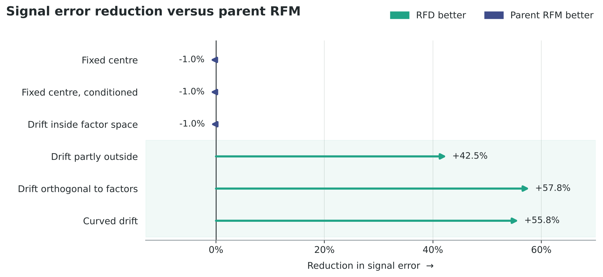
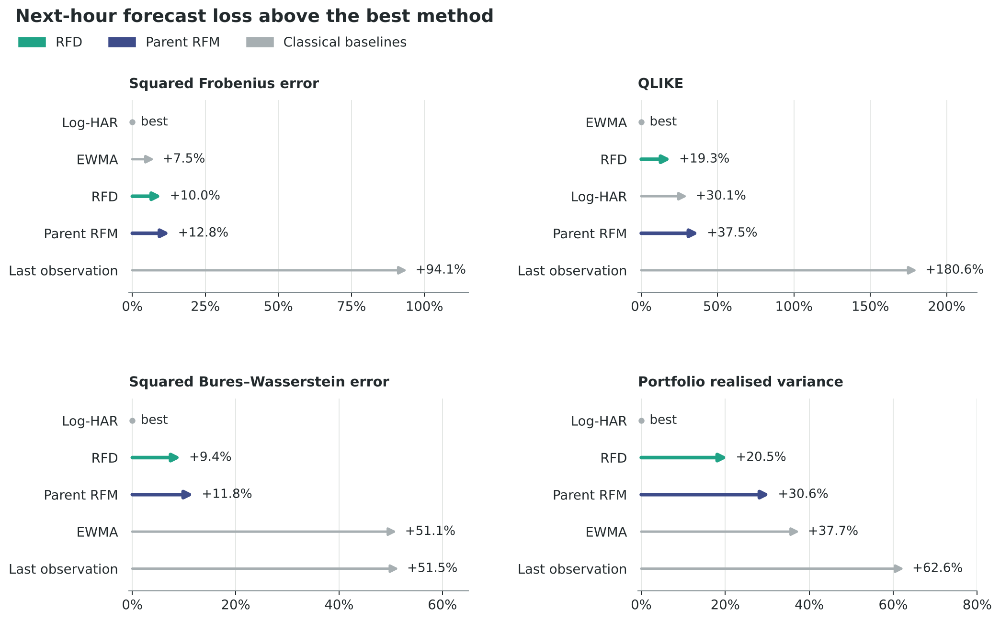
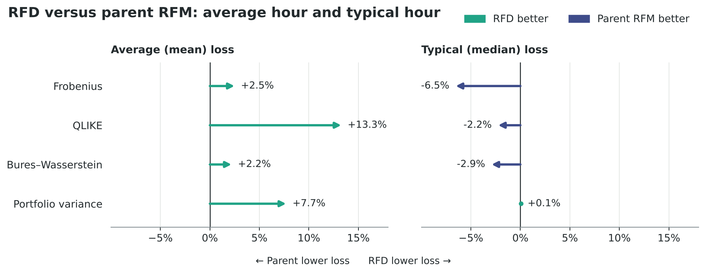

# Riemannian Factor Dynamics

A portfolio's risk depends less on how much each asset moves than on how the
assets move together. That information sits in a covariance matrix, and every
risk number built on it (portfolio variance, hedge ratios, the weights of a
minimum-variance portfolio) is only as good as the forecast of that matrix.

Covariance does not sit still. Markets spend long stretches in a calm regime
and then shift into a stressed one, where volatilities rise and assets start
moving as one. On top of that slow shift sit shorter shocks that many assets
share. A risk model that confuses the two will misread both: it treats a
regime change as a string of shocks, or a shock as a new normal.

Factor models describe those shared shocks with a few common drivers. The
[Riemannian factor model (RFM)](https://arxiv.org/abs/2607.28385) of Huang,
Chen and Chen does this for whole covariance matrices, and keeps every
estimate a valid covariance matrix. It measures each period against one fixed
baseline: the average covariance over the sample.

**RFD lets that baseline move.** It estimates a path for the normal level of
risk over time, measures each period against the baseline of that moment, and
only then looks for the common drivers. A slow change of regime goes into the
baseline; the shocks around it go into the factors.

This repository asks when that separation pays off.

## What we found

### In simulations, a moving baseline matters when the regime shifts in a new direction



*Simulated covariance series with a known answer. When the baseline drifts in
a direction the common drivers cannot describe, RFD recovers the true signal
with 42 to 58% less error, and it wins all 288 paired runs across every sample
size. When the baseline is
fixed, or drifts along a direction the drivers already cover, the fixed-baseline
model is about 1% better. Median over 24 runs per setting at 8,192
observations, with the true number of factors given to both models.
[Full report](results/synthetic/report.md)*

The third row is the subtle case. There, RFD tracks the baseline 60% more
accurately, yet reconstructs no better, because the fixed-baseline model
absorbs the drift into its factors. Real markets may often look like this:
in the parent paper's stock data, the main factor itself tracks the VIX. Which
movement counts as "regime" and which as "shock" is partly a modelling
choice, set here by how smoothly the baseline is allowed to move.

### On crypto markets, RFD lowers average risk-forecast error but does not beat simple methods



*Forecasts of the next hour's 20 × 20 covariance matrix for 20 crypto assets,
for every hour of 2025, with all modelling choices fixed on 2024 data. Losses
are shown as the percentage above the best method on each measure. The last
panel is the most practical one: build a minimum-variance portfolio from each
forecast and measure how much it actually moved. A 20 × 20 covariance matrix
has 210 separate entries; both factor models describe their movement with 19
common factors. RFD (teal) has lower average
loss than the fixed-baseline model (purple) on all four measures, including
7.7% less realised portfolio variance, but the difference is within
statistical noise. Classical methods (grey) still lead every measure.
[Full report](results/crypto/report.md)*



*RFD wins the average hour but loses slightly on the typical hour for three of
the four measures. Its gains come from a minority of hours where the
fixed-baseline model makes large errors. For risk management those are the
hours that matter most, but this result alone does not show they are the
stressed ones. These compare each model's own mean and median, not
hour-by-hour differences.*

## Install and try it

Python 3.10 or newer.

```bash
git clone https://github.com/AdarshArunEire/Riemannian-Factor-Dynamics.git
cd Riemannian-Factor-Dynamics
python -m venv .venv && source .venv/bin/activate   # Windows: .venv\Scripts\Activate.ps1
pip install -e .
python examples/quickstart.py
```

To fit your own sequence:

```python
import numpy as np
from rfd import BW_GEOMETRY, RFDConfig, fit_rfd

covariances = np.load("covariances.npy")  # (n, m, m), symmetric positive definite
time = np.linspace(0, 1, len(covariances))

fit = fit_rfd(covariances, time, BW_GEOMETRY,
              RFDConfig(bandwidth=0.2, n_cells=4, max_lag=2, rank_method="fixed", rank=2))

fit.factor_scores, fit.loadings, fit.centre.polygon, fit.reconstructed_observations
```

`bandwidth` is in the units of `time`, `n_cells` sets the number of segments in
the centre path, and `max_lag` sets how many lags enter factor extraction.
`AIRM_GEOMETRY` and `SPHERE_GEOMETRY` are also available.

## Layout

```
rfd/            the package
  model.py      fit_rfd: centre path → transport → factors → reconstruction
  forecast.py   forecasting, baselines and losses
  simulate.py   synthetic data generators
  data.py       minute bars to hourly covariance matrices
  _maths/       geometry and estimators used by the model
experiments/    scripts that produce the results above
results/        reports, tables and figures
tests/
```

## Reproduce

```bash
pip install -e ".[test]"
pytest                               # unit tests
python experiments/figures.py        # redraw the figures from results/
```

**Synthetic comparison.** Needs R, the packages in `renv.lock` and the parent's
code (see [reference/README.md](reference/README.md)). The full run took about
10 hours on eight workers.

```bash
Rscript -e "renv::restore(prompt = FALSE)"
python experiments/synthetic.py --profile smoke --check-r
python experiments/synthetic.py --profile overnight --workers 8
python experiments/synthetic.py --analyze
```

**Crypto study.** Downloads Binance public minute data, then runs four stages.
This is a substantial download and compute run.

```bash
pip install -e ".[experiments]"
python experiments/crypto/data.py --profile full
python experiments/crypto/centre.py
python experiments/crypto/representation.py
python experiments/crypto/forecast.py
```

## Licence

AGPL-3.0. The parent model is the work of Shuo-Chieh Huang, Rong Chen and
Yaqing Chen; this repository builds on their paper and does not include their
code.
